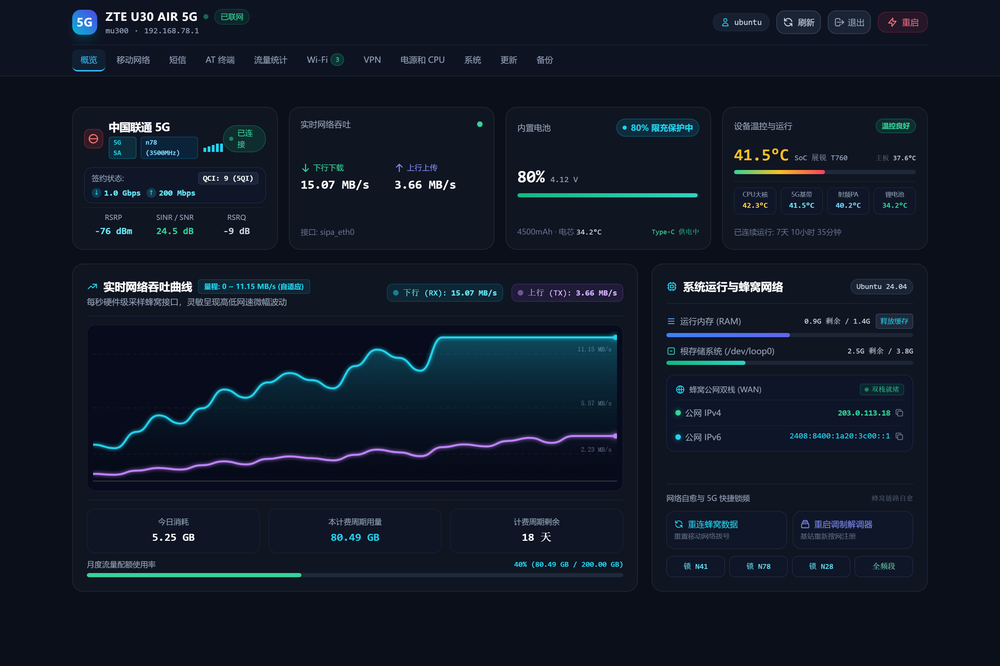
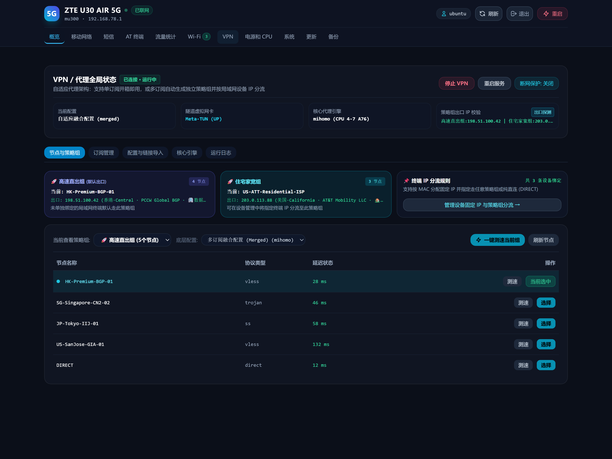
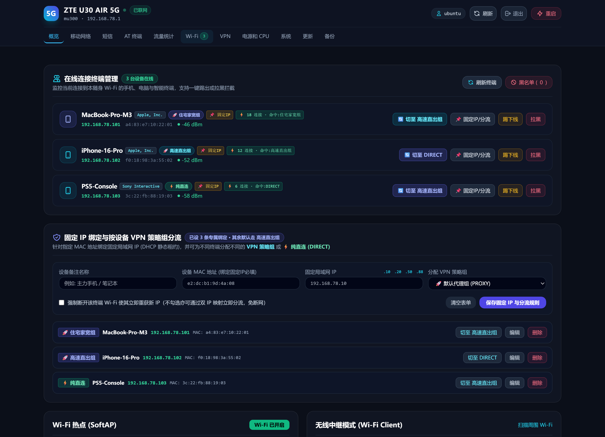
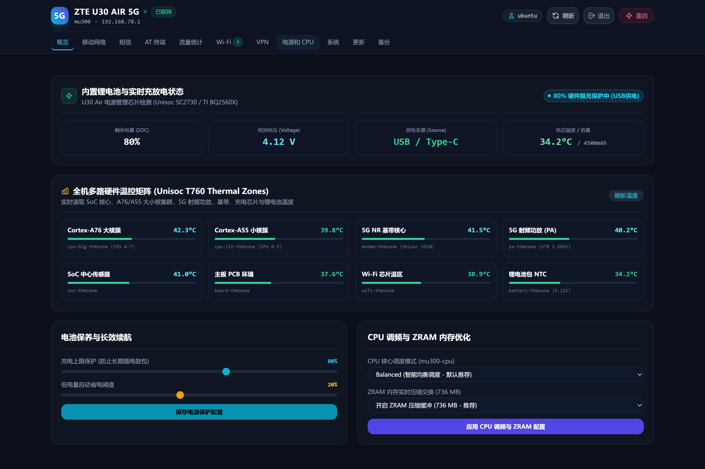

# mu300-webui — Standalone Ubuntu 24.04 LTS Distribution, Offline Flasher & Lightweight Web Console for ZTE U30 Air (`mu300`)

**English** | **[简体中文](./README_CN.md)**

[](https://github.com/Yunsuding/mu300-webui/actions/workflows/ci.yml)
[](./LICENSE)
[](https://github.com/Yunsuding/mu300-webui/releases/tag/baseline-v2026.10.27.2)

A self-contained **Ubuntu 24.04.5 LTS (ARM64) standalone maintenance distribution, two-stage offline flashing suite, patched Mihomo transparent proxy stack, SQC 0mA hardware charge limiter, and ultra-lightweight `:8080` Web Console** built for the **ZTE U30 Air 5G Pocket Router (`mu300`, Unisoc T7510 / UDX710)**.

With upstream `mu300-linux` shifting focus to OpenWrt, this repository preserves and enhances the battle-tested **`Ubuntu 24.04.5 LTS + Vendor Linux 5.4.254 (v2026.10.27.2)`** stack so any ZTE U30 Air can be flashed, provisioned, and maintained **100% offline with zero upstream dependency**:
- **Starting from Stock Rooted Android**: Safely flash any new or second-hand U30 Air in ~10 minutes without touching per-device IMEI/RF calibration partitions;
- **Already running `mu300-linux` (Ubuntu 24.04)**: Upgrade in seconds via `install.sh` or `python deploy.py --with-runtime`.

---

## 📸 Screenshots

| **Overview Dashboard (5G SA & Telemetry)** | **Adaptive Multi-Subscription Mihomo Routing** |
| :---: | :---: |
|  |  |
| **Wi-Fi Clients & Dual-Stack Split Routing** | **SQC 0mA Hardware Bypass & 8-Zone Thermal Matrix** |
|  |  |

---

## ✨ Highlights

1. **Safe Multi-Unit Offline Flashing (`standalone/`)**:
   - **`backup_nv_windows.py`**: Cross-platform (Windows/macOS/Linux) ADB backup & SHA256 verifier for all 29 critical per-device IMEI, 5G RF calibration, and bootchain partitions before flashing.
   - **Blob-Free Base Installer**: Uses the verified `mu300-magisk-v2026.10.27.2-ubuntu-24.04-k5.4.zip` offline installer, which extracts modem/Wi-Fi firmware directly from each target device's own Android partitions—100% safe across multiple U30 Air units.
   - **One-Click Stage-2 Provisioner (`provision_device.py`)**: Offline SSH installer that deploys our patched VPN + Mihomo ARM64 engine, GeoIP/GeoSite databases, 0mA SQC charge bypass, Cortex-A76 big-core affinity, eMMC wear-reduction tuning, and `:8080` WebUI while removing the 110 MB+ legacy Cockpit 9090 panel.
2. **Ultra-Lightweight `:8080` Web Console (`~15 MB` RAM) + Dual-SIM & Baseband Control Center**:
   - Pure Python 3 standard-library backend + bundled offline `tailwindcss.js` SPA.
   - **Ubuntu 24.04 Dual-SIM Live Hot-Switch (`SIM 1 sipa_eth0 ↔ SIM 2 sipa_eth8`)**: Dedicated Slot 2 AT brokers (`mu300-atd4`/`atd5`), **non-intrusive 8-pin SIM contact & `EF_DIR`/`ISD-R` eUICC probe** (`sim.probe_slot`, verifies modded Nano-SIM / `9eSIM` / `ESTK` / `5ber` cards without dropping SIM 1), live `AT+SPSWDATA` data switch with 45s WAN watchdog auto-rollback, **timed OTP flash-switch** (`30–300s` guaranteed auto-return), and per-ICCID independent traffic ledgers with quota auto-failover.
   - **5G RF, SMS/OTP Push, USSD & Signaling Call Center**: 5-step cellular health check, one-click band locking (`n41` / `n78` / `n28`), fast redial, per-SIM APN & VoLTE/VoNR toggles, slot-aware SMS inbox with 4–8 digit OTP extraction, multi-channel push (`Bark` / `Telegram Bot` / `Webhook`) + incoming call (`+CLIP`) auto-hangup alert, interactive USSD (`*101#`), signaling call dialer/DTMF keep-alive, and 8-zone thermal monitoring.
3. **Adaptive Single / Multi-Subscription Mihomo Proxy & Dual-Stack Client Routing**:
   - Add one or multiple Clash/Mihomo subscriptions directly in the WebUI to auto-build isolated policy groups with live exit-IP probing.
   - Bind individual Wi-Fi/LAN clients to specific policy groups or `DIRECT` with automatic IPv4 (`/32`) + SLAAC global IPv6 (`/128`) rule injection, private Unix socket control (`/run/mu300-vpn/mihomo-control.sock`), Sniffer `502` protection, and automatic Tailscale bypass coexistence.
4. **Hardware-Level 0mA Battery Bypass & Performance Tuning**:
   - Programs Unisoc 5.4 charger IC `REG01` + `REG05` watchdog for true **0mA battery bypass** when plugged in 24/7 (prevents lithium battery swelling), pins Mihomo to **CPU 4–7 (Cortex-A76)**, keeps 5G online when Wi-Fi is idle, and caps `journald` at 8 MB to protect the 3.9 GB eMMC.

---

## 🚀 Quick Start

### Track A: Flash a Stock Rooted Android U30 Air (100% Offline Capable)

See **[`docs/MANUAL_FLASH_AND_MAINTENANCE.md`](./docs/MANUAL_FLASH_AND_MAINTENANCE.md)** for the step-by-step handbook.

```bash
# 1. Clone repo & install PC helper dependency (paramiko)
git clone https://github.com/Yunsuding/mu300-webui.git
cd mu300-webui
pip install -r requirements.txt

# 2. Download & SHA256-verify offline flashing + patched VPN/Mihomo bundles (~231 MB essential)
python standalone/fetch_offline_bundles.py --essential-only

# 3. [Step 0 - On Rooted Android] Backup this unit's 29 unique IMEI/RF calibration partitions
python standalone/backup_nv_windows.py

# 4. [Step 1] Unpack device-backups/offline-bundles/mu300-magisk-v2026.10.27.2-ubuntu-24.04-k5.4.zip
#    and run start.cmd / start.sh (select Ubuntu 24.04 + Kernel 5.4; set Panel=No, VPN=No)

# 5. [Step 2 - Once booted into Ubuntu at 192.168.78.1] Inject full stack offline
python standalone/provision_device.py --host 192.168.78.1 --mode clean
```

Then open **`http://192.168.78.1:8080/`** and sign in with your Ubuntu credentials!

---

### Track B: Already Running `mu300-linux` (Ubuntu 24.04)

- **On-device install**:
  ```bash
  git clone https://github.com/Yunsuding/mu300-webui.git /tmp/mu300-webui
  cd /tmp/mu300-webui && sudo bash install.sh --all -y
  ```
- **Remote SFTP deploy from PC**:
  ```bash
  cp .env.example .env      # Set SSH_PASSWORD (defaults to SSH_HOST=192.168.78.1)
  python deploy.py --with-runtime
  ```

---

## 🛠️ Offline Verification

Run syntax checks, inline JavaScript checks, and SHA256 verification across all 280 standalone runtime files without a device:

```bash
python scripts/check.py
```

---

## 📜 License & Acknowledgments

- Released under the **[MIT License](./LICENSE)**.
- Built on top of [`dikeckaan/mu300-linux`](https://github.com/dikeckaan/mu300-linux) (MIT License) and interoperates with [`MetaCubeX/mihomo`](https://github.com/MetaCubeX/mihomo) (GPL-3.0). See **[`THIRD_PARTY_NOTICES.md`](./THIRD_PARTY_NOTICES.md)** for full details.
