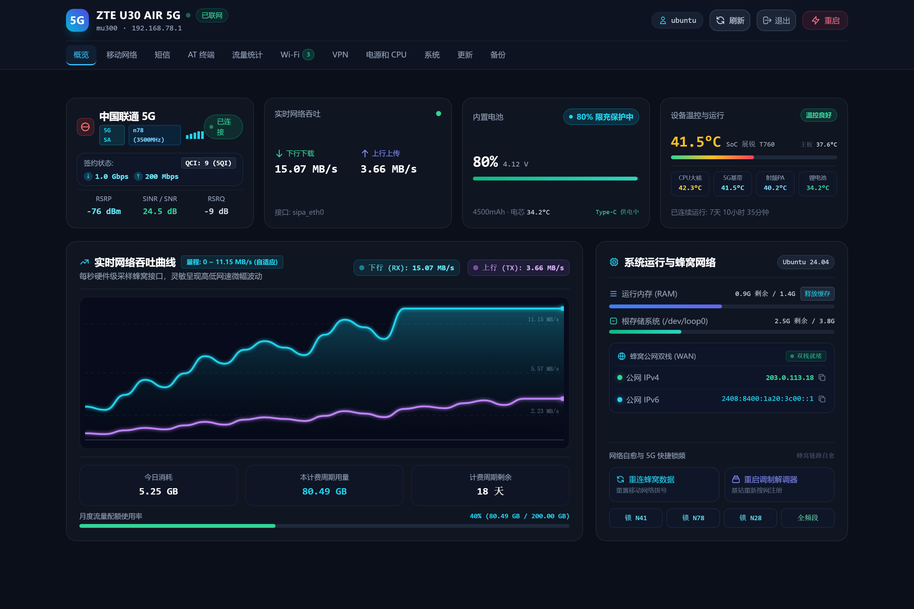
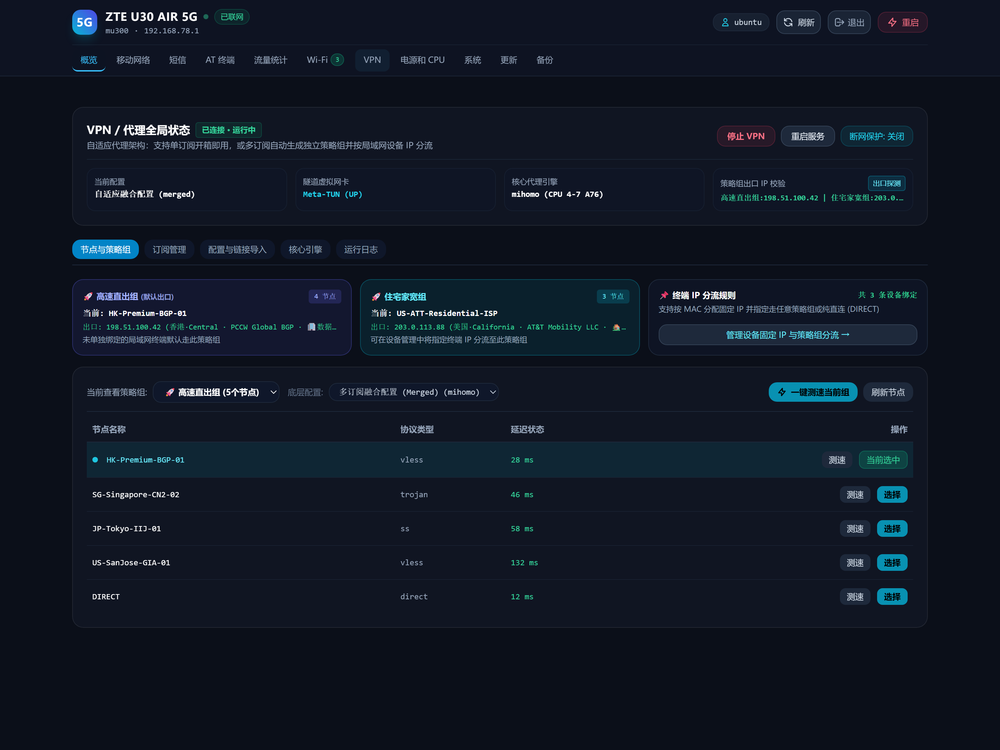
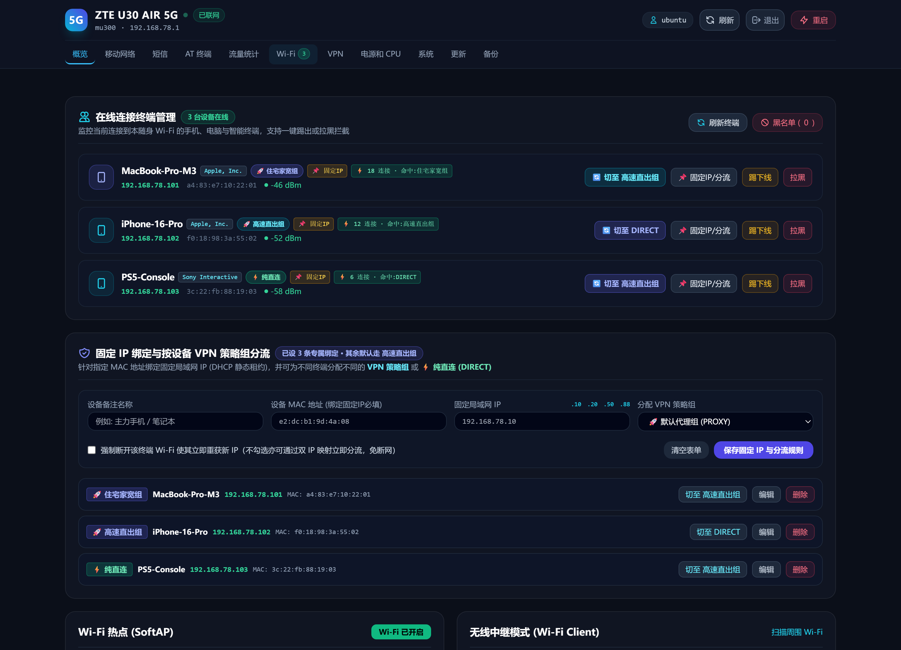
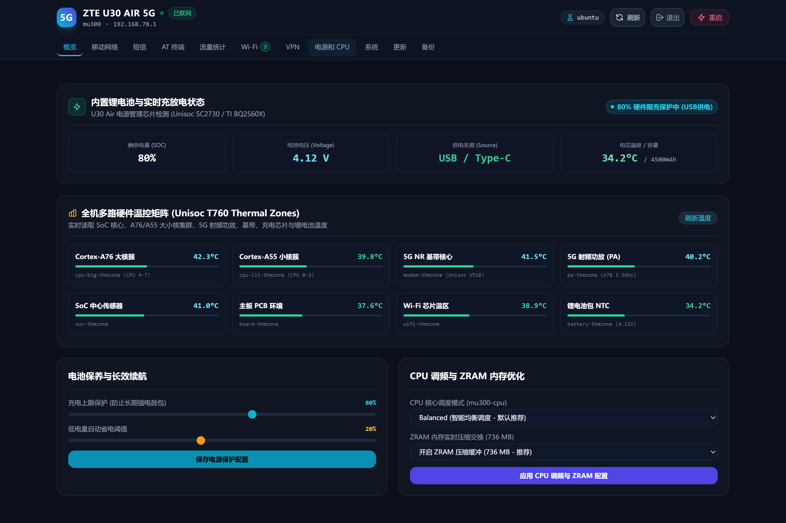

# mu300-webui — ZTE U30 Air (`mu300`) Ubuntu 24.04 LTS 独立发行版、全离线刷机套件与极轻量 Web 控制台

**[English](./README.md)** | **简体中文**

[](https://github.com/Yunsuding/mu300-webui/actions/workflows/ci.yml)
[](./LICENSE)
[](https://github.com/Yunsuding/mu300-webui/releases/tag/baseline-v2026.10.27.2)

专为 **中兴 ZTE U30 Air 5G 随身路由器（紫光展锐 T7510 / UDX710，代号 `mu300`）** 打造的 **Ubuntu 24.04 LTS 独立维护发行版、两段式全离线刷机套件与 `:8080` 极轻量 Web 控制台**。

由于上游 `mu300-linux` 已转向主攻 OpenWrt 分支，本项目将经过实机长期验证的 **`Ubuntu 24.04.5 LTS + 展锐原厂 Linux 5.4.254 (v2026.10.27.2)`** 完整运行底座、跨平台离线刷机包、深度优化的 **Mihomo 透明代理套件**、**SQC 0mA 零循环硬件旁路充电保护**以及仅占 `~15MB` 内存的自研控制台整合为一套 **100% 脱离上游在线依赖** 的完整开源方案：
- **全新 / 原厂 Android 设备**：按下方三步离线向导，10 分钟即可安全刷成满血 Ubuntu 随身服务器（自动提取本机驱动，绝不跨机覆盖 IMEI/射频校准分区）；
- **已刷过 `mu300-linux` (Ubuntu 24.04) 的设备**：一行 `install.sh` 或 `deploy.py` 即可无缝升级安装。

---

## 📸 界面预览 (Screenshots)

| **全局概览大盘 (5G SA 信号 / 实时吞吐 / 快捷锁频)** | **单/多订阅自适应融合与出口 IP 探测** |
| :---: | :---: |
|  |  |
| **在线终端管理与按设备双栈分流绑定** | **SQC 0mA 硬件旁路限充与 8 温区传感器矩阵** |
|  |  |

---

## ✨ 核心特性

### 1. 全离线异机安全刷机与独立固件底座 (`standalone/`)
- **同款异机 100% 安全不串号**：内置跨平台 `backup_nv_windows.py`（刷前一键导出并 SHA256 校验新机独有的 29 个 IMEI / 5G 射频校准与引导分区），配合不含私有固件的全合一离线刷机包自动提取目标机自身基带/Wi-Fi 固件。
- **二阶段一键满血注入 (`provision_device.py`)**：进入 Ubuntu 后约 30 秒全离线装入**改版 VPN + Mihomo ARM64 核心 + Geo 规则库 + SQC 0mA 旁路限充 + Cortex-A76 大核亲和性 + `:8080` 控制台**，并自动清除高内存占用的旧版 9090 Cockpit 面板。
- **GitHub Release 黄金底包直连拉取**：运行 `python standalone/fetch_offline_bundles.py` 免登录直接拉取全部离线包并逐字节校验 SHA256。

### 2. 极轻量全功能 Web 控制台 (`:8080`) 与双卡基带通信中心
- **零第三方后端依赖**：纯 Python 3 标准库实现的高并发守护进程，常驻内存仅 `~15MB`（彻底取代占 `110MB+` 内存的 Cockpit）。
- **纯离线极速渲染**：采用离线预编译静态 `app.css`（gzip 仅 `6.5KB`）+ 模块化 `app.js`（`immutable` 强缓存、零运行时 JIT 编译开销），在 SIM 卡停机、地下车库无网或弱网环境下依然秒开顺滑。
- **Ubuntu 24.04 双卡在线热切 (`SIM 1 sipa_eth0 ↔ SIM 2 sipa_eth8`) 与改卡无损触点检测**：
  - 独立双槽 AT 守护进程（`mu300-atd` + `mu300-atd4`），支持在卡 1 保持 5G 不断网的前提下，一键对卡 2 执行 **8 脚物理触点、`CPIN`、`ICCID`/`IMSI` 及 `EF_DIR` / `ISD-R`（`9eSIM` / `ESTK` / `5ber` 实体 eUICC 容器）无损检测**；
  - 支持将任意流量卡插入卡 2 后一键 **在线热切换主上网卡**（45 秒未获取到 IP 自动回退原卡防失联）、**闪切接码防失联模式**（30~300 秒收完验证码或倒计时到点强制切回主卡）以及**按 ICCID 独立流量账本与达量自动切备用卡**。
- **5G 射频精控与全功能通信中心**：内置 5 步蜂窝健康诊断条、**5G 频段一键锁定 (`n41` / `n78` / `n28`)**、秒级快速重拨、分卡槽独立 APN / 漫游 / VoLTE / VoNR 管理、双槽短信收发与 4~8 位验证码一键提取、**Bark / Telegram Bot / Webhook 多通道推送**、来电识别（`+CLIP`）自动拒接通知、交互式 USSD（`*101#` 等）、信令保号拨号盘（DTMF）与 8 温区监控。

### 3. 单/多订阅自适应 Mihomo 透明代理与 IPv4/IPv6 双栈分流
- **无需手写 YAML**：在网页端 **「VPN / 代理」 → 「订阅管理」** 直接添加 1 个或多个 Clash / Mihomo 订阅链接：
  - **单订阅模式**：一键拉取节点、并发测速、零断流热切节点；
  - **多订阅自动融合模式**：添加多个订阅并自定义策略组名称（如 `高速主力` + `住宅家宽`），自动合并生成独立策略组并实时探测各组出口 IP；
  - **按设备双栈分流**：在 **「Wi-Fi 与客户端」** 页面一键为手机/电脑固定 IP 并绑定指定策略组或 `DIRECT`，同时自动捕获终端 SLAAC 公网 IPv6 地址注入 `/128` 规则，杜绝移动端双栈漏流。
- **私有 Unix Socket 控制 + 防 502 / 防 Tailscale 断联**：通过 `/run/mu300-vpn/mihomo-control.sock` 毫秒级切节点（零 TCP 控制端口暴露）；限制 Sniffer 端口为 `80, 443, 8443` 根治 8080 面板 `502`；检测到安装 Tailscale 时自动置顶 `tailscaled` 与 `3478` 端口直连。

### 4. 硬件级电池防鼓包与闪存延寿优化
- **SQC 0mA 零循环硬件旁路限充 (`mu300-sqc-charge`)**：直接控制展锐 5.4 内核充电 IC `REG01 (CHG_CONFIG)` 与 `REG05` 看门狗，达到设定上限（长期插电推荐 `60%`，移动外出可设 `80%` 或点「充满一次」）后切断电池充电电流实现 **0mA 外部 USB 直供**，彻底告别锂电池长期满电鼓包。
- **Mihomo 绑定 Cortex-A76 大核 (`CPUAffinity=4-7`)**：将代理加解密固定在 4 颗 A76 大核，把 4 颗 A55 小核留给 `multi-sipa-0` 5G 基带硬中断，单线程代理吞吐翻倍。
- **5G 常在线与 eMMC 日志防爆守护**：默认配置 `WIFI_IDLE=0` / `RADIO_IDLE=keep` 保持无 Wi-Fi 客户端时蜂窝不断网；强制 `journald` 8MB 上限与定时清理，保护 3.9GB 闪存。

---

## 🚀 快速开始

### 路径 A：原厂 Android 新机 / 二手机 → 全离线刷入满血 Ubuntu 系统

> 📖 **完整零 AI 图文级实操教程**：请阅读 **[`docs/MANUAL_FLASH_AND_MAINTENANCE.md`](./docs/MANUAL_FLASH_AND_MAINTENANCE.md)**。

```bash
# 1. 克隆仓库并安装电脑端 SSH/校验依赖
git clone https://github.com/Yunsuding/mu300-webui.git
cd mu300-webui
pip install -r requirements.txt

# 2. 一键下载并 SHA256 校验离线刷机底包 + 改版 VPN/Mihomo 包（核心包约 231 MB）
python standalone/fetch_offline_bundles.py --essential-only

# 3. 【第 0 步：Android Root 状态下】备份该台机器独有的 29 个 IMEI/射频校准分区
python standalone/backup_nv_windows.py     # Windows 可直接双击 standalone/01_备份新机校准分区_Android状态.cmd

# 4. 【第 1 步】解压 device-backups/offline-bundles/mu300-magisk-v2026.10.27.2-ubuntu-24.04-k5.4.zip
#    运行里面的 start.cmd / start.sh（选择 Ubuntu 24.04 + Kernel 5.4，Panel 与 VPN 均选 No）

# 5. 【第 2 步：重启进入 Ubuntu 后】一键离线注入改版 VPN + 0mA 限充 + :8080 控制台
python standalone/provision_device.py --host 192.168.78.1 --mode clean
# （Windows 可直接双击 standalone/02_一键注入满血系统_Ubuntu启动后.cmd）
```

完成后打开浏览器访问 **`http://192.168.78.1:8080/`**（使用你的 Ubuntu 系统账号密码登录）即可！

---

### 路径 B：设备已在运行 `mu300-linux` (Ubuntu 24.04) → 直接安装/更新面板与优化

- **方式 1（在设备上直接运行）**：
  ```bash
  git clone https://github.com/Yunsuding/mu300-webui.git /tmp/mu300-webui
  cd /tmp/mu300-webui
  sudo bash install.sh --all -y
  ```
- **方式 2（从电脑端通过 SFTP 一键部署）**：
  ```bash
  cp .env.example .env      # 填入 SSH_PASSWORD（默认连接 192.168.78.1）
  python deploy.py --with-runtime
  ```

---

## 📦 目录结构

```text
.
├── u30air-webui/                   # :8080 极轻量 Web 控制台后端、离线前端与辅助脚本
├── standalone/                     # Ubuntu 24.04 + k5.4 独立底座与全离线刷机套件
│   ├── 01_备份新机校准分区_Android状态.cmd / backup_nv_windows.py
│   ├── 02_一键注入满血系统_Ubuntu启动后.cmd / provision_device.py
│   ├── fetch_offline_bundles.py    # Release 离线包下载与 SHA256 校验器
│   ├── bundle-manifest.json        # 9 个黄金离线包精确字节与 SHA256 清单
│   ├── device-runtime/             # 280 项实机脱敏系统运行时、改版 VPN 脚本与调优规则
│   └── upstream-installer/         # 跨平台底座安装器与本地离线中文网页说明
├── docs/
│   ├── MANUAL_FLASH_AND_MAINTENANCE.md  # 零 AI 手工刷机与长期维护全指南
│   └── screenshots/                # 控制台界面预览图
├── manage.py                       # PC 端远程运维 CLI (status / exec / webui-restart / reboot)
├── deploy.py                       # PC 端 SFTP 热部署工具 (支持 --check 与 --with-runtime)
├── scripts/                        # 离线语法/JS/SHA256 自检 (check.py) 与端口监听 (monitor.py)
├── install.sh / uninstall.sh       # 设备端本地安装与卸载脚本
├── THIRD_PARTY_NOTICES.md          # 第三方开源组件版权与许可证声明
└── LICENSE                         # MIT 开源许可证
```

---

## 🛠️ 离线自检与开发验证

无需连接真实设备即可在任意电脑运行全量语法、前端内联 JS 与 280 项运行时文件 SHA256 校验：

```bash
python scripts/check.py
```

---

## 📜 开源许可证与致谢 (License & Acknowledgments)

- 本项目采用 **[MIT License](./LICENSE)** 开源。
- 衷心感谢 [`dikeckaan/mu300-linux`](https://github.com/dikeckaan/mu300-linux)（MIT License）奠定的 ZTE U30 Air Linux 引导与硬件抽象基础，以及 [`MetaCubeX/mihomo`](https://github.com/MetaCubeX/mihomo)（GPL-3.0）强大的代理内核支持。详见 [`THIRD_PARTY_NOTICES.md`](./THIRD_PARTY_NOTICES.md)。
